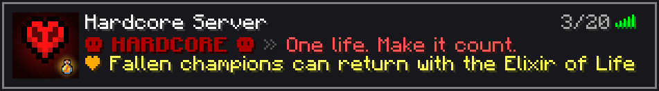
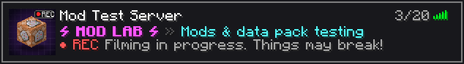

# minecraftHardcore

Add-ons for the hardcore server, plus server-list branding for all three servers: hardcore, creative (test) and mod test.

## Server list icons and descriptions

| Server | Preview |
|---|---|
| Hardcore |  |
| Creative |  |
| Mod test |  |

Each folder under `server/` holds:
- `server-icon.png`: the 64×64 icon. Copy it into the server's main folder (next to `server.properties`) with exactly that name.
- `motd.properties`: the description line. Replace the `motd=` line in `server.properties` with it. Special characters are escaped so they display correctly.
- `motd.txt`: the same description in readable form, for editing.

Restart the server afterwards; both are only read at startup.

To change the text, edit `motd.txt` and run `python3 tools/make_server_icons.py <path to a Minecraft client .jar>`. That rebuilds the icons, previews and `motd.properties`, and warns if a line is too long to fit.

## Fabric, voice chat and the /info book

`prompts/fabric-migration.md` is a ready-to-paste prompt for Claude Code on the server. It moves the hardcore server to Fabric with a verified backup and a rollback, adds Simple Voice Chat, and installs the Server Info book.

- **Server Info book** (`datapack/server_info`): new players get it on their first join, and anyone can get a new copy with `/info` or `/trigger info`. It covers:
  - welcome text
  - a clickable link to download Simple Voice Chat, with one line of setup
  - the Elixir of Life recipe, where hovering shows the actual items
  - how reviving works
- **`/info` command** (`fabric-mods/info-command`): a tiny server-side Fabric mod, since a data pack can't add new commands.
- **Update checker** (`tools/check_fabric_updates.sh`): stages newer Fabric loader, Fabric API and Simple Voice Chat builds for the same Minecraft version, with hash checks.

Tested on a Fabric 26.3 server with Simple Voice Chat 2.6.24:
- A client without mods joins and isn't kicked.
- The book arrives on first join.
- `/info` and `/trigger info` both hand out the book, which has the voice chat link and the item tooltips.

## RivalBot and Race the Bot

A free bot (`rivalbot/`) that plays survival like a real player on the mod test server, learns from its deaths, and races you to the End. In the race data pack (`datapack/rival_race`), the System announcer roots for the bot and sabotages you. See [rivalbot/README.md](rivalbot/README.md) for what it can do so far and how to run it.

## Challenge: Minecraft, but my health is my inventory

A data pack for recording challenge videos, made for the mod test server.

- **The rule: 10 hearts = 10 slots.** Your hotbar (9 slots) plus your offhand are your whole inventory, and the 27 backpack slots are locked. Each heart you lose locks a slot, starting with the offhand and then from the right end of the hotbar. Whatever was in that slot falls on the ground. Heal and the slots unlock again. At one heart you only have your first hotbar slot.
- **Goal:** beat the game by killing the Ender Dragon. You get a win screen, fireworks and stats (time, deaths, hearts lost, items dropped).
- **The System:** a sarcastic, kid-friendly AI announcer, written in the spirit of Dungeon Crawler Carl. It comments when you start, lose a slot, drop items, heal, fall, burn, get blown up, find diamonds, enter the Nether and the End, die, and win. Every line also shows in chat as `[SYSTEM] …`. Small comments share a 5 second cooldown so it doesn't talk over itself; big moments always play.
- **On screen:** an intro ("Minecraft, but… My health is my inventory"), a 3-2-1 countdown, and a bar above the hotbar showing hearts = slots and a timer.

| Command | What it does |
|---|---|
| `/function hpinv:start` | Starts the challenge for everyone online. It clears inventories, heals everyone, switches them to Survival, and changes Peaceful to Normal |
| `/function hpinv:stop` | Ends it and unlocks every slot |
| `/function hpinv:admin/stats` | Shows time, deaths, hearts lost and items dropped |
| `/function hpinv:admin/hud_toggle` | Hides or shows the hearts and timer bar, for clean footage |

The announcer voice needs `resourcepack/health_inventory_voice` (build it with `python3 tools/make_announcer.py --build`). To change what the System says, edit `tools/health_inventory_lines.json` and run `python3 tools/make_announcer.py`. That regenerates the voice clips and the `voice/*.mcfunction` files together. Tested end to end with a bot player on 1.21.11 (25 checks, `tests/challenge_e2e.js`), and every command was checked on 26.3.

## Elixir of Life

A data pack that lets players bring fallen champions back in a hardcore world, plus server-wide death and resurrection announcements.

- **Elixir of Life.** Craft it from a Golden Apple and a Potion of Weakness. Right-click it to open a menu of fallen players, then pick one to revive.
- **Revival.** The player comes out of spectator mode at their spawn point (bed, respawn anchor or `/spawnpoint`). They get 15 seconds of protection and a notice saying who revived them.
- **Death announcement.** Everyone hears a cannon shot, then the announcer says *"System message. A champion has fallen."* A message also appears in small text just below the crosshair, the player's name shows in the action bar, and chat names them too.
- **Resurrection announcement.** Everyone hears an angelic chime, then the announcer says *"System message. A resurrection has occurred…"* followed by *"…the champion has returned to the realm."* The on-screen text works the same way as for a death.

Announcements are heard by every player on the server at full volume. The voice lines are stereo, so they sound the same from every direction instead of coming from one spot.

### Supported versions

Java Edition **1.21.9 to 26.3**. Bedrock is not supported.

| Version | How it was tested |
|---|---|
| 1.21.11 | Full end-to-end test with two bot players (30 checks) |
| 26.1.2 | Full end-to-end test with two bot players (30 checks) |
| 26.2 | Pack loads without errors |
| 26.3 | Pack loads without errors, and every command was checked by running it on the server |

26.3 changed several data formats. The `overlay_26_3` folder holds the 26.3 versions of those files, and the game picks the right ones automatically.

### Install

1. **Data pack.** Copy `datapack/elixir_of_life` (or `dist/elixir_of_life_datapack.zip`) into `<world>/datapacks/`. Then run `/reload` or restart the server.
2. **Set the fallback spawn.** Stand at the world spawn and run:
   ```
   /function elixir:admin/set_world_spawn
   ```
   Revived players with no bed or respawn anchor are sent here. If this isn't set, they appear next to the player who used the elixir.
3. **Resource pack (announcer voice).** The voice lines only play for players who have the resource pack. Everything else works without it. Either:
   - **Server resource pack (recommended).** Upload `dist/elixir_of_life_resourcepack.zip` somewhere with a public direct-download link, then set this in `server.properties`:
     ```
     resource-pack=https://your-host/elixir_of_life_resourcepack.zip
     resource-pack-sha1=<sha1 printed by tools/make_voices.py>
     require-resource-pack=false
     ```
     The easiest host is a GitHub release on this repo (it's public): attach the zip to a release and use the asset's download link. Every rebuild changes the SHA-1, so publish each new zip as a new release and update both lines. Then restart the server.
   - **Manual.** Each player puts the zip in `.minecraft/resourcepacks/` and enables it.

Build the zips with `python3 tools/make_voices.py --build`. The command also prints the SHA-1.

### Playing

1. Put a **Golden Apple** and a **Potion of Weakness** (normal or extended) into any crafting grid.
   - With any other potion, the elixir "curdles": you get the golden apple back but lose the potion.
   - Automatic crafters make an *unrefined* elixir that does nothing. It has to be crafted by hand.
2. Hold the **Elixir of Life** and right-click. A menu lists every fallen champion.
3. Click a name. The elixir is used up, and that player:
   - goes back to Survival at their bed or respawn anchor. If those are gone, they go to the fallback spawn.
   - gets Resistance V, Slow Falling, Fire Resistance, Water Breathing and Regeneration, so the fall, lava or water where they land can't kill them right away.
   - sees "You Have Been Revived" below the crosshair, with the reviver's name in the action bar.
4. Offline players can be revived too. They return the next time they join.

A dead hardcore player has to click **Spectate World** on the death screen before they can be revived.

### Admin commands

| Command | What it does |
|---|---|
| `/function elixir:admin/give` | Gives you an Elixir of Life |
| `/function elixir:admin/revive {name:"Steve"}` | Revives a player without using an elixir |
| `/function elixir:admin/list` | Shows who is fallen and who is waiting to be revived |
| `/function elixir:admin/set_world_spawn` | Sets the fallback spawn to where you're standing |
| `/function elixir:admin/uninstall` | Removes the pack's scoreboards and storage (then run `/datapack disable`) |

### Saying each player's name in the announcement

By default the announcer says *"…a champion has returned to the realm"*, and the player's name is shown on screen. To have the voice say the name:

1. Add the names to `tools/players.txt`, one per line. Use `Name=how to say it` for names the voice mispronounces.
2. Run `pip install piper-tts` (also needs `ffmpeg`), then `python3 tools/make_voices.py`.
3. Reinstall the data pack and the resource pack. If you host the resource pack, update `resource-pack-sha1`.

Voices are made offline with [Piper](https://github.com/rhasspy/piper) (`en_US-ryan-high`), with a little echo added.

### Layout

```
datapack/elixir_of_life/       the data pack
  data/elixir/function/        death, use, revive, craft, announce, admin logic
  overlay_26_3/                26.3 versions of the advancements, loot tables and item modifier
resourcepack/elixir_of_life_sounds/   announcer voice lines
tools/make_voices.py           makes the voice lines and builds dist/*.zip
tools/make_server_icons.py     makes the server icons, MOTD lines and previews
server/hardcore, server/creative, server/modtest   server-list icon and description for each server
tests/                         end-to-end test with bot players
```

### Running the tests

You need Java 21 (1.21.x) or Java 25 (26.x), Node.js and Python 3.

```
cd tests && npm install
./setup_server.sh /tmp/mc 25571 25581        # then put a server.jar in /tmp/mc and start it
node e2e.js                                  # PORT, RCON and VER env vars select the server
```
